# wörds – Benutzerhandbuch

wörds ist eine Karteikarten-App für das, was man in einer Sprache täglich üben muss: Verbformen und Wörter des
Alltags. Jede Karte zeigt eine Seite. Du antwortest im Kopf, drehst die Karte um und bewertest dich ehrlich – oder du
tippst die Antwort ein, und wörds prüft sie. wörds berechnet dann, wann du die Karte wiedersehen solltest.

wörds funktioniert offline, braucht kein Konto und zeigt keine Werbung. Mitgeliefert wird Italienisch für
Deutschsprachige (Verben A1 und 120 Wörter des Alltags); weitere Sprachpakete lassen sich aus einer Datei oder von
GitHub hinzufügen, und du kannst eigene erstellen, auch aus Fotos einer Wortliste.

Dieses Handbuch beschreibt wörds 0.11.1. Die Bildschirmfotos zeigen das Farbschema Terrakotta; deine App kann
andere Farben haben.

## Inhalt

- [Erste Schritte](#erste-schritte)
- [Die Bibliothek](#die-bibliothek)
- [Eine Sitzung starten](#eine-sitzung-starten)
- [Mit einer Karte lernen](#mit-einer-karte-lernen)
- [Die Antwort eintippen](#die-antwort-eintippen)
- [Ende einer Sitzung](#ende-einer-sitzung)
- [Heutige Wiederholung](#heutige-wiederholung)
- [Erinnerung und Widget](#erinnerung-und-widget)
- [Fortschritt](#fortschritt)
- [Artikel üben](#artikel-üben)
- [Sprachpakete](#sprachpakete)
- [Eigene Pakete](#eigene-pakete)
- [Wörter aus Fotos](#wörter-aus-fotos)
- [Einstellungen](#einstellungen)
- [Tablets und Foldables](#tablets-und-foldables)
- [Barrierefreiheit und Datenschutz](#barrierefreiheit-und-datenschutz)
- [Fragen und Probleme](#fragen-und-probleme)

## Erste Schritte

Beim ersten Start installiert wörds die mitgelieferten Inhalte und fragt, was du lernen möchtest. Wähle ein
Sprachpaar und tippe auf **Los geht's**. Weitere Sprachpaare kannst du später installieren und jederzeit wechseln.

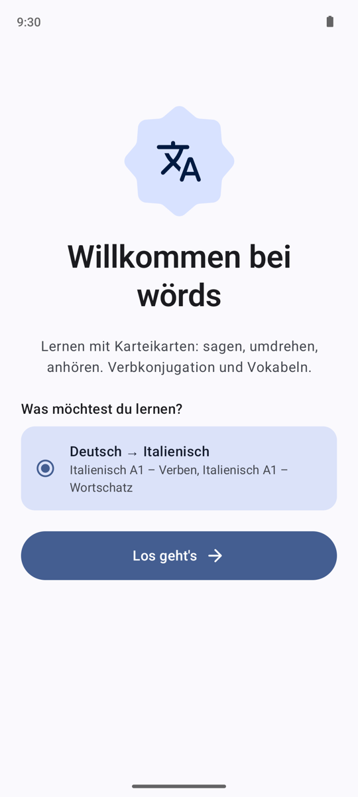

Die App hat drei Bereiche, die du immer über die Leiste unten erreichst (auf Tablets: an der Seite):

| Bereich | Wofür |
|---|---|
| **Bibliothek** | Inhalte ansehen und eine Sitzung starten |
| **Fortschritt** | Die heutige Wiederholung und was du bisher gelernt hast |
| **Einstellungen** | Sprache, Farben, Aussprache, tägliche Wiederholung, Sprachpakete |

## Die Bibliothek

Die Bibliothek zeigt alles, was du im aktuellen Sprachpaar lernen kannst. Mit den Chips oben wechselst du zwischen
den installierten Paketen, zum Beispiel *Verben* (Konjugation) und *Wortschatz* (Vokabeln). Jedes Paket ist in
Abschnitte (Lektionen) gegliedert, jeder Abschnitt in Einträge: ein Verb mit all seinen Formen oder ein Wort.

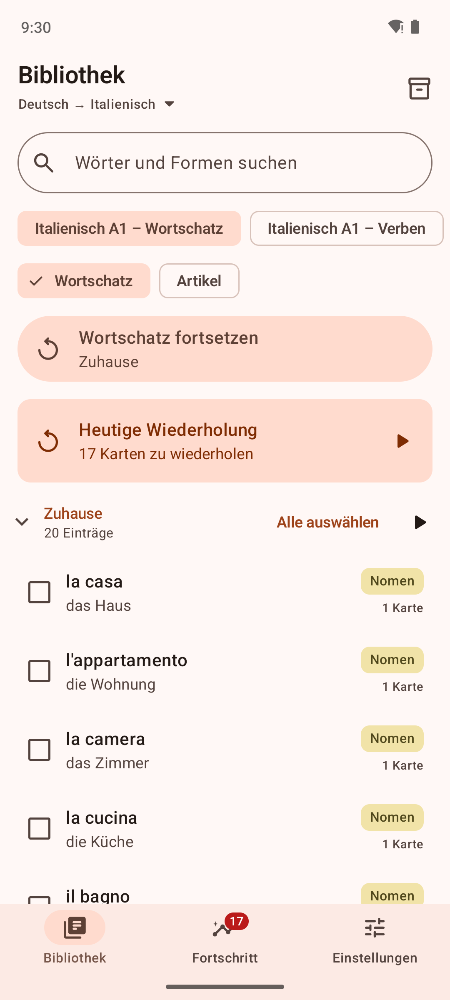 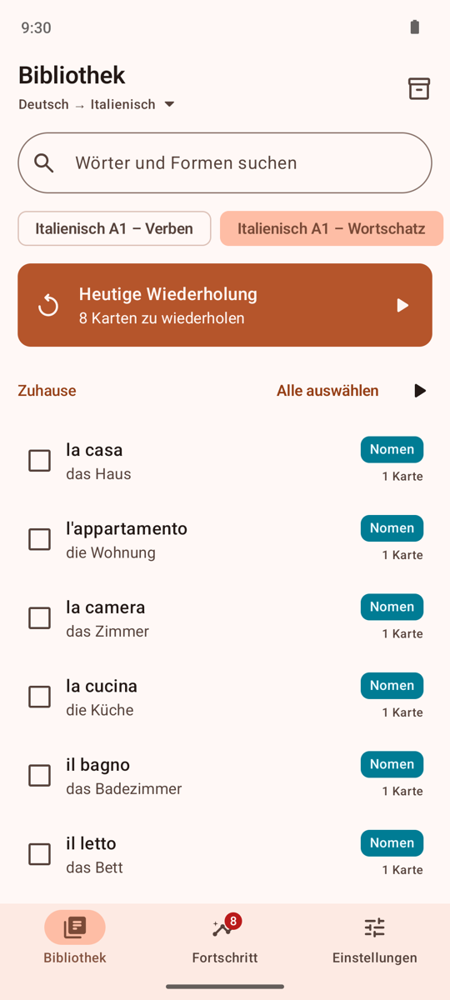

- **Suchen** findet Wörter und Verbformen im ausgewählten Paket.
- **Heutige Wiederholung** oben startet deine tägliche Wiederholung oder setzt sie fort (siehe
  [Heutige Wiederholung](#heutige-wiederholung)).
- **Letzte Sitzung fortsetzen** erscheint, solange eine Sitzung offen ist; sie geht genau dort weiter, wo du
  aufgehört hast.
- Die **▶-Taste** neben einem Abschnitt startet den ganzen Abschnitt.
- Sind zwei oder mehr Sprachpaare installiert, tippst du auf das Sprachpaar unter dem Titel, um zu wechseln.
- Das **Kisten-Symbol** oben rechts öffnet die [Sprachpakete](#sprachpakete).

Willst du nur einige Einträge lernen, hakst du sie an. **Alle auswählen** hakt einen ganzen Abschnitt an;
**Leeren** oben hebt die Auswahl auf. Die Taste unten zeigt, wie viele Einträge du gewählt hast.

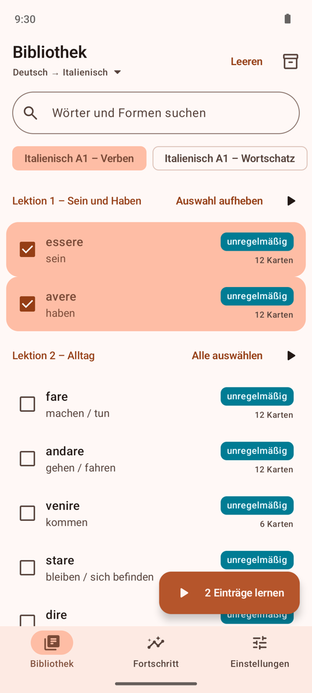 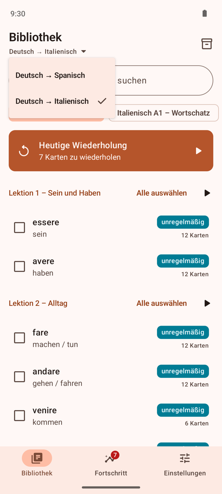

## Eine Sitzung starten

Bevor eine Sitzung beginnt, legst du in einem Blatt fest, wie du üben willst:

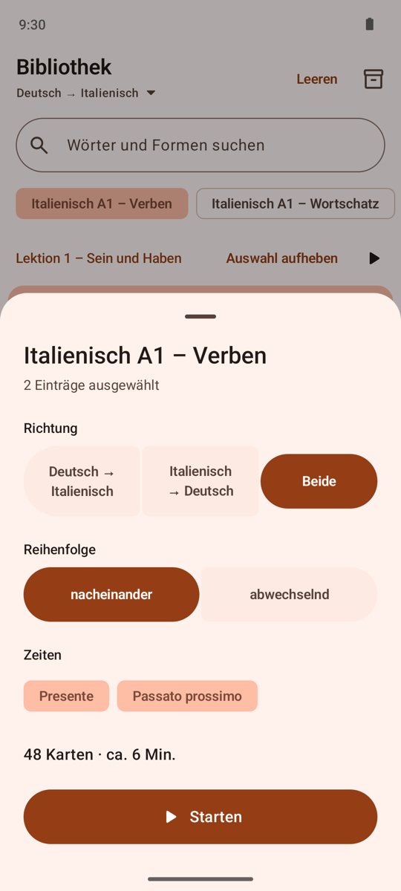

- **Richtung**: von deiner Sprache in die Lernsprache (*Deutsch → Italienisch*: du siehst „ich bin" und sagst
  „io sono"), umgekehrt oder **Beide**.
- **Reihenfolge** (nur bei *Beide*): **nacheinander** übt alle Karten eines Eintrags erst in der einen, dann in der
  anderen Richtung. **abwechselnd** fragt jede Karte im Wechsel in beiden Richtungen ab.
- **Zeiten** (nur bei Verben): welche Zeitformen du üben willst.
- **Antwort**: die Karte **Umdrehen** und dich selbst bewerten, oder die Antwort **Eintippen** (siehe
  [Die Antwort eintippen](#die-antwort-eintippen)). wörds merkt sich deine Wahl für jedes Sprachpaar.

Das Blatt zeigt, wie viele Karten das sind und wie lange es ungefähr dauert. Tippe auf **Starten**.

## Mit einer Karte lernen

Eine Karte zeigt eine Aufgabe. Sag oder denk die Antwort, dann tippe auf die Karte, um sie umzudrehen.

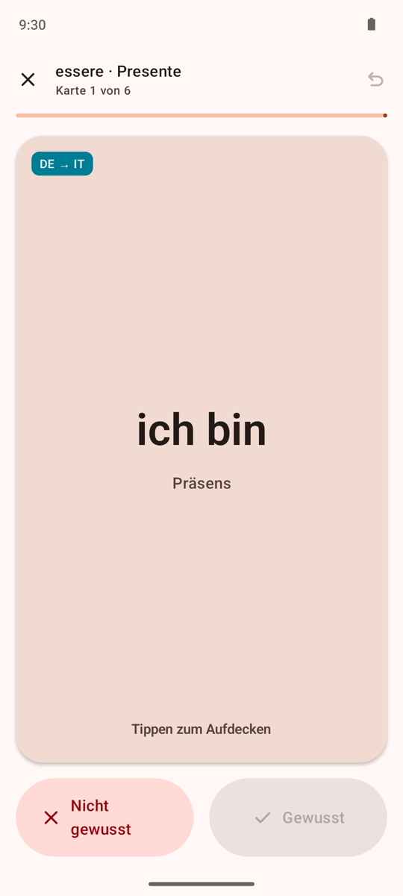 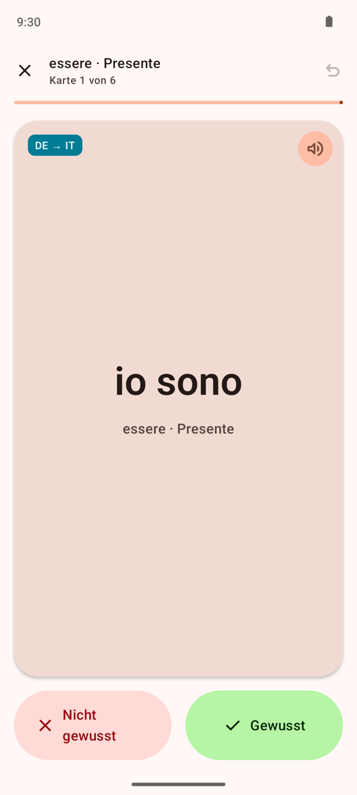

Dann bewertest du dich:

- **Gewusst** – oder die Karte nach rechts wischen.
- **Nicht gewusst** – oder die Karte nach links wischen.

Sei ehrlich: wörds plant deine Wiederholungen nach diesen Antworten. Deshalb ist **Gewusst** auch erst möglich,
wenn die Antwort zu sehen ist. Tippst du vor dem Umdrehen auf **Nicht gewusst**, zeigt die Karte zuerst die
Antwort; ein zweites Tippen auf **Nicht gewusst** geht weiter.

Außerdem auf dem Kartenbildschirm:

- Der **Lautsprecher** spielt die Aussprache mit der Sprachausgabe deines Geräts ab. Fehlt die Stimme für die
  Sprache, bietet wörds an, sie zu installieren.
- **Rückgängig** (der Pfeil oben rechts oder die Meldung unten) nimmt die letzte Antwort zurück.
- Das Schild oben links zeigt die Richtung, zum Beispiel *DE → IT*.
- **✕** schließt die Sitzung. Sie bleibt offen, und du kannst sie später in der Bibliothek fortsetzen.

**Vokabelkarten** zeigen das Wort und auf der Antwortseite Artikel, Plural und, wenn das Paket einen hat, einen
Beispielsatz. Viele Wörter des mitgelieferten Italienisch-Pakets haben außerdem ein Bild ihrer Bedeutung. In den
Einstellungen kannst du die Bilder ausschalten.

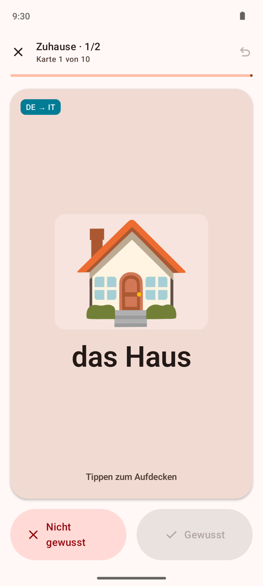 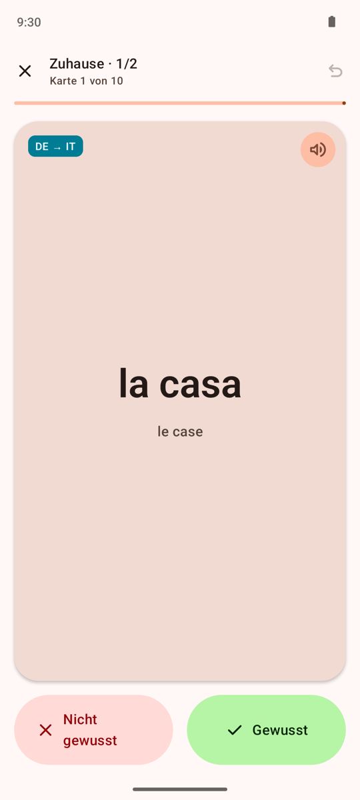

## Die Antwort eintippen

Mit **Antwort: Eintippen** nimmt ein Feld deine Antwort in der Sprache der Kartenrückseite entgegen, und die Tastatur
wechselt nach Möglichkeit in diese Sprache. Tasten über der Tastatur fügen Buchstaben ein, die ihr fehlen können,
etwa *à* oder *è*. Tippe auf **Prüfen** (oder drücke die Eingabetaste).

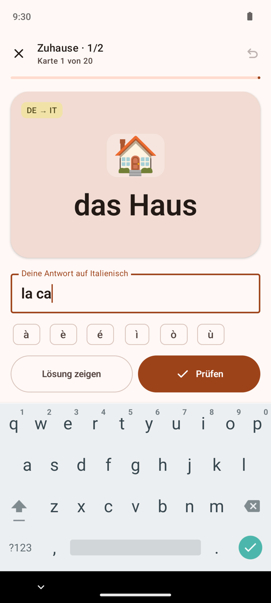 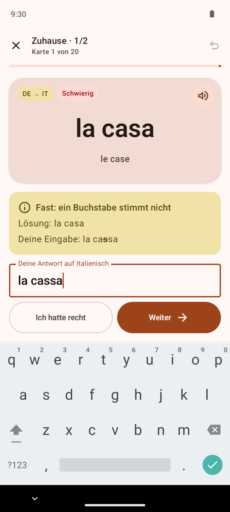

wörds vergleicht deine Antwort mit der Lösung und sagt, was es gefunden hat:

- **Richtig** zählt als gewusst.
- **Fast** – ein Buchstabe falsch in einem längeren Wort, nur die Akzente (wenn akzeptiert), der falsche Artikel
  oder kein Artikel (wenn akzeptiert) – zählt als *fast gewusst*: Die Karte kommt früher wieder als eine gewusste,
  aber später als eine vergessene.
- **Nicht ganz** zählt als nicht gewusst.

Groß- und Kleinschreibung, zusätzliche Leerzeichen und Satzzeichen spielen nie eine Rolle. Bietet eine Lösung
Alternativen an (*lui/lei è*), ist jede davon richtig, und ein Subjektpronomen, mit dem die Lösung beginnt, darf fehlen
(*sono* für *io sono*). Unter dem Ergebnis zeigt die Lösung, was gefehlt hat oder anders war, und deine Eingabe, was
falsch war.

Liegt wörds daneben, tippe auf **Ich hatte recht**, dann zählt die Antwort als gewusst. **Lösung zeigen** gibt eine
Karte auf; sie zählt dann als nicht gewusst. Was du eintippst, wird nie gespeichert.

Eintippen geht in beiden Richtungen. Für die heutige Wiederholung schaltest du es unter **Einstellungen → Tägliche
Wiederholung → Antworten eintippen** ein.

## Ende einer Sitzung

Eine Sitzung ist in Gruppen aufgeteilt: eine pro Verb und Zeit oder eine Handvoll Wörter. Nach jeder Gruppe zeigt
wörds, wie es lief und was als Nächstes kommt. Am Ende siehst du das Ergebnis der ganzen Sitzung.

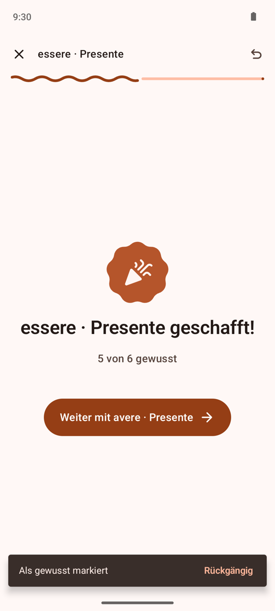 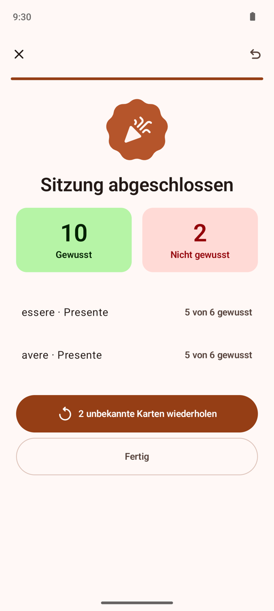

**Unbekannte Karten wiederholen** startet eine kurze Sitzung nur mit den Karten, die du nicht wusstest.
**Fertig** führt zurück in die Bibliothek.

## Heutige Wiederholung

wörds arbeitet mit *verteilter Wiederholung*: Eine Karte, die du gut kannst, kommt erst nach langer Pause wieder,
eine schwierige bald. Dahinter steckt FSRS, ein modernes Planungsverfahren, das für jede Karte schätzt, wie
wahrscheinlich du sie noch weißt.

Jeden Tag stellt wörds die **heutige Wiederholung** zusammen:

- fällige Karten, zuerst die, die du am ehesten vergisst, und
- einige **neue Karten** aus Paketen, mit denen du schon angefangen hast (20 am Tag, wenn du nichts änderst).

Du startest die Wiederholung oben in der Bibliothek oder im Bereich **Fortschritt**. Eine Zahl am Bereich
Fortschritt zeigt, wie viele Karten warten. Lange Wiederholungen sind in Blöcke zu 20 Karten aufgeteilt. Eine
unterbrochene Wiederholung kannst du am selben Tag fortsetzen. Ein Lerntag beginnt um 4 Uhr morgens, damit eine
Sitzung spät am Abend noch zu diesem Tag zählt.

Jede Antwort fließt in deinen Plan ein: in einer normalen Sitzung genauso wie in der Wiederholung.

## Erinnerung und Widget

**Einstellungen → Tägliche Wiederholung → Tägliche Erinnerung** schickt zur gewählten Uhrzeit eine Benachrichtigung
(19:00 Uhr, wenn du nichts änderst), aber nur an Tagen, an denen die heutige Wiederholung noch Karten für dich hat.
Beim Einschalten fragt sie nach der Erlaubnis für Benachrichtigungen; die Benachrichtigung nennt keine Wörter.

Das Widget **Heutige Wiederholung** für den Startbildschirm zeigt, wie viele Karten warten, und startet die
Wiederholung mit einem Tipp. Wenn du für heute fertig bist, sagt es das und öffnet den Fortschritt. Es übernimmt die
Farben der App.

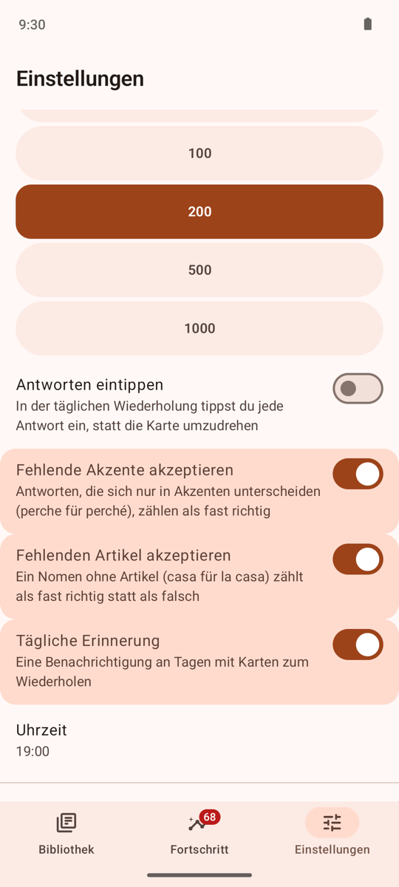

## Fortschritt

Der Bereich **Fortschritt** zeigt die heutige Wiederholung und für jedes Paket, wie weit du bist. Tippe auf ein
Paket, um dieselben Zahlen pro Abschnitt zu sehen; innerhalb eines Abschnitts kannst du seine Gruppen einblenden.

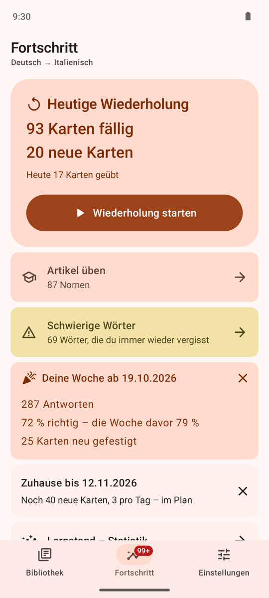 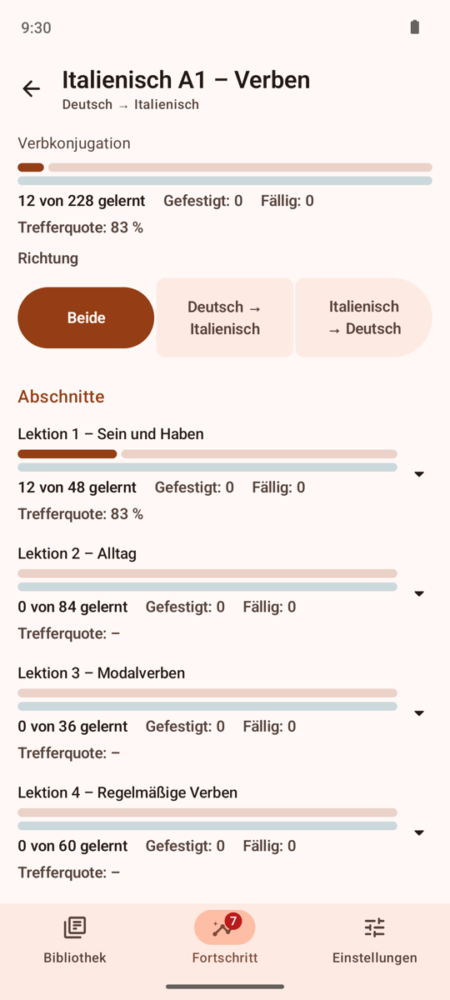

| Angabe | Bedeutung |
|---|---|
| **gelernt** | Karten, die du mindestens einmal beantwortet hast |
| **Gefestigt** | Karten, die du auch nach drei Wochen oder mehr noch wüsstest |
| **Fällig** | Karten, die jetzt zur Wiederholung anstehen |
| **Trefferquote** | Anteil der Antworten mit *Gewusst* |

Mit den Tasten unter **Richtung** siehst du die Zahlen für eine Richtung oder für beide.

Über den Paketen zeigt der Fortschritt:

- **Schwierige Wörter**: Wörter, die du dreimal oder öfter vergessen hast, nachdem du sie schon konntest. Tippe auf
  die Karte, um sie zu sehen. In der Liste kannst du ein Wort **bearbeiten** (ein Wort eines installierten Pakets
  bearbeitest du in einer Kopie des Pakets, die deinen Fortschritt übernimmt) oder **zurücksetzen**, um es von vorn
  zu lernen. Ein Wort verschwindet aus der Liste, sobald du es drei Wochen lang behältst. In der Bibliothek, im Editor
  und auf der Antwortseite einer Karte sind diese Wörter als **Schwierig** markiert.
- **Die nächsten 7 Tage**: wie viele Karten an jedem Tag fällig sind; überfällige zählen für heute.
- **Die letzten 12 Wochen**: ein Kalender der Tage, an denen du gelernt hast; je dunkler ein Tag, desto mehr Antworten.
  **Als Liste zeigen** schreibt beide Diagramme als Tabelle aus.

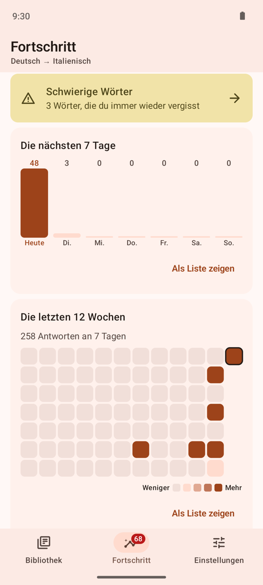 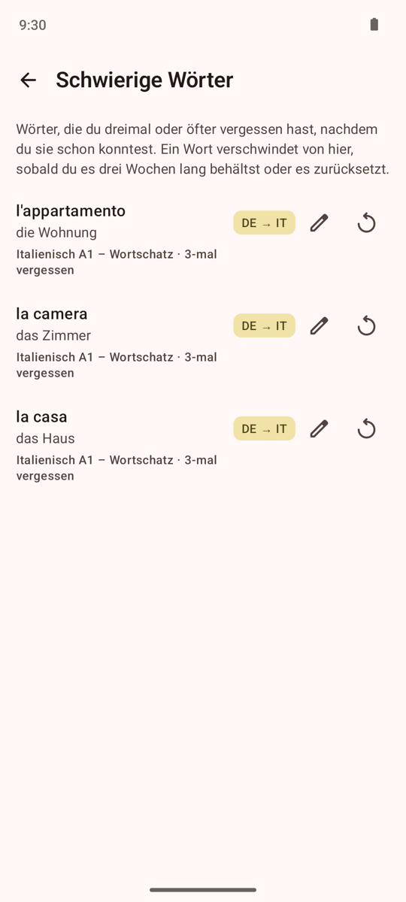

## Artikel üben

**Artikel üben** fragt nur nach dem Artikel von Nomen: *casa* – heißt es *il*, *lo*, *la* oder *l'*? Du findest es in
der Bibliothek (für das gewählte Paket) und im Fortschritt (für alle Pakete des Sprachpaars), sobald es mindestens fünf
Nomen mit ihrem Artikel gibt.

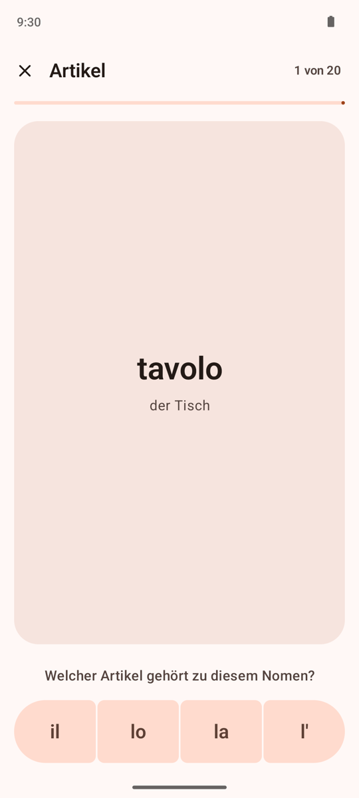 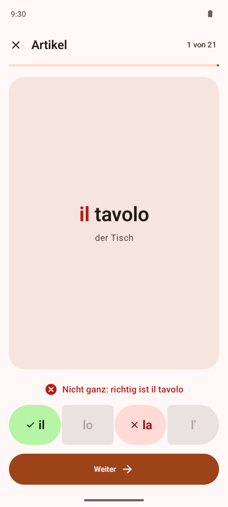

Eine Runde hat bis zu 20 Nomen. Nach einer richtigen Antwort folgt das nächste Nomen von selbst; nach einer falschen
zeigt wörds den richtigen Artikel, bis du auf **Weiter** tippst, und fragt das Nomen am Ende der Runde noch einmal. Die
nächste Runde beginnt mit den Nomen, die falsch waren.

Das Artikeltraining ändert weder deinen Plan noch die heutige Wiederholung, aber seine Antworten zählen im Kalender.

## Sprachpakete

Alle Inhalte kommen in Sprachpaketen. Du öffnest sie über das Kisten-Symbol in der Bibliothek oder über
**Einstellungen → Sprachpakete**.

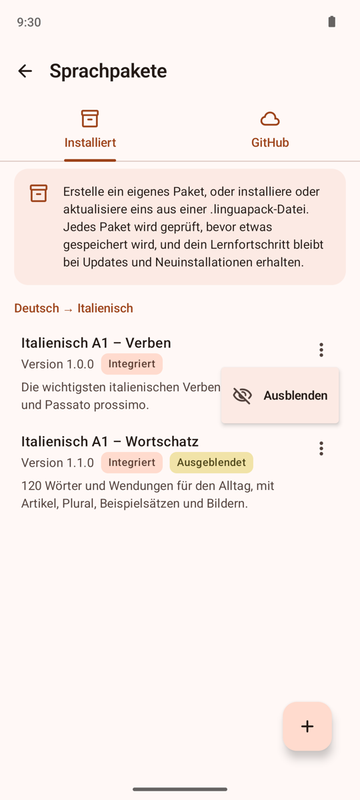 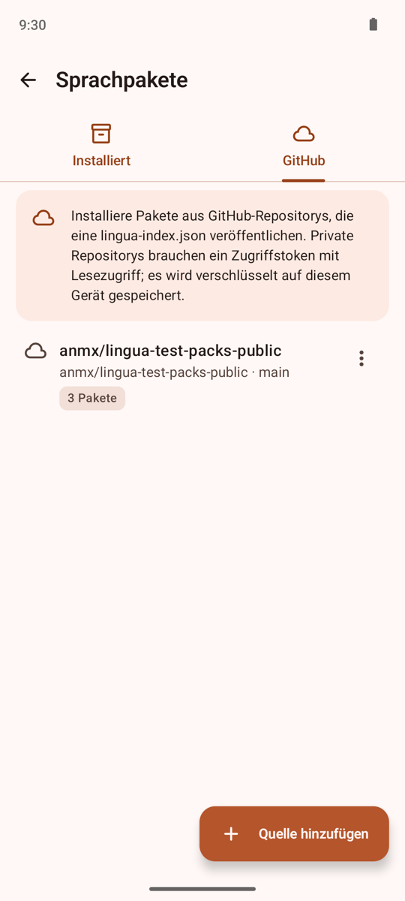

**Installiert** listet deine Pakete nach Sprachpaar, mit Version und Herkunft (*Integriert*, *Importierte Datei*
oder *GitHub*).

- **Datei importieren** installiert oder aktualisiert ein Paket aus einer `.linguapack`-Datei, zum Beispiel aus
  deinen Downloads.
- Das Papierkorb-Symbol entfernt ein Paket. Dein Lernfortschritt bleibt erhalten und ist wieder da, wenn du das
  Paket erneut installierst. Mitgelieferte Pakete lassen sich nicht entfernen.

**GitHub** installiert Pakete aus GitHub-Repositorys, die ein Paketverzeichnis (`lingua-index.json`)
veröffentlichen:

1. Tippe auf **Quelle hinzufügen** und gib Inhaber und Namen des Repositorys ein. Du kannst auch einen GitHub-Link
   in das Feld Inhaber einfügen. Branch und Ordner sind optional.
2. Für ein **privates** Repository fügst du ein Fine-grained-Zugriffstoken hinzu, das nur Lesezugriff auf die
   Inhalte dieses Repositorys hat. wörds speichert es verschlüsselt, mit einem Schlüssel, der dein Gerät nie
   verlässt. Ein gespeichertes Token anzeigen, ersetzen oder löschen geht nur mit Fingerabdruck, Gesicht oder
   Displaysperre.
3. Speichere. wörds zeigt die Pakete, die das Repository anbietet. Tippe auf **Installieren**.

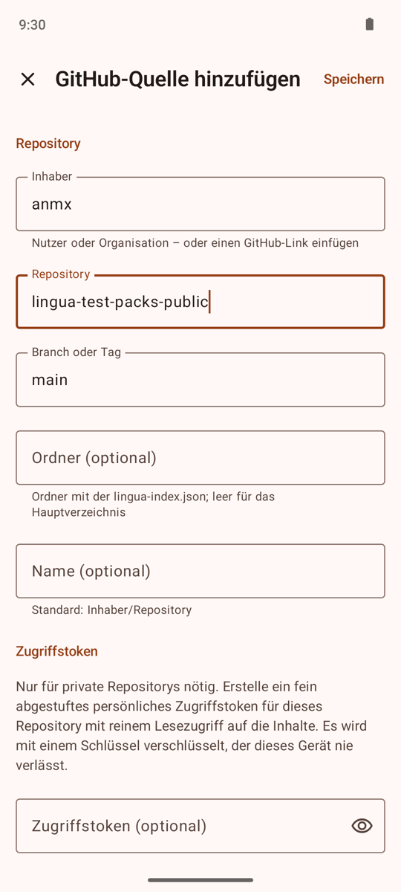 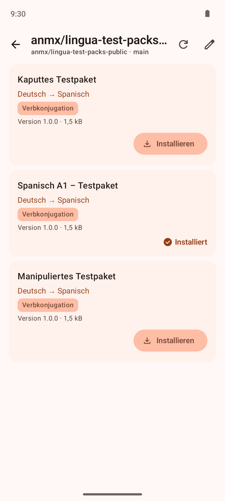

Einmal am Tag prüft wörds im WLAN, ob deine Quellen neue Versionen haben, und zeigt dann **Aktualisieren** an.
Große Downloads laufen mit einer Benachrichtigung im Hintergrund weiter.

**Jedes Paket wird geprüft, bevor etwas gespeichert wird.** Eine beschädigte Datei, ein Paket, das nicht zu seiner
Prüfsumme passt, oder Inhalt, der gegen die Regeln verstößt, wird abgelehnt, und wörds sagt dir, warum. Auf
deinem Gerät ändert sich dann nichts.

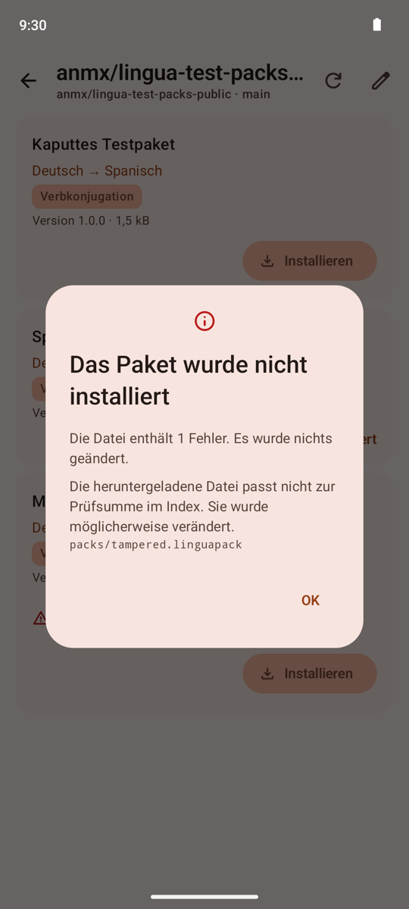

## Eigene Pakete

Erstelle ein Paket mit deinen eigenen Wörtern, zum Beispiel den Vokabeln deines Lehrbuchs, und lerne damit wie mit
jedem anderen Paket.

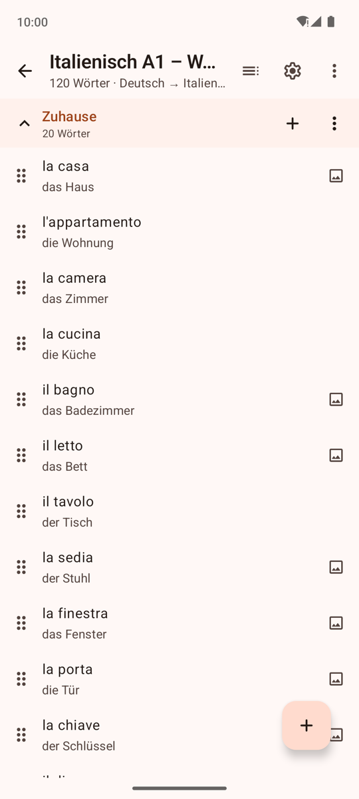 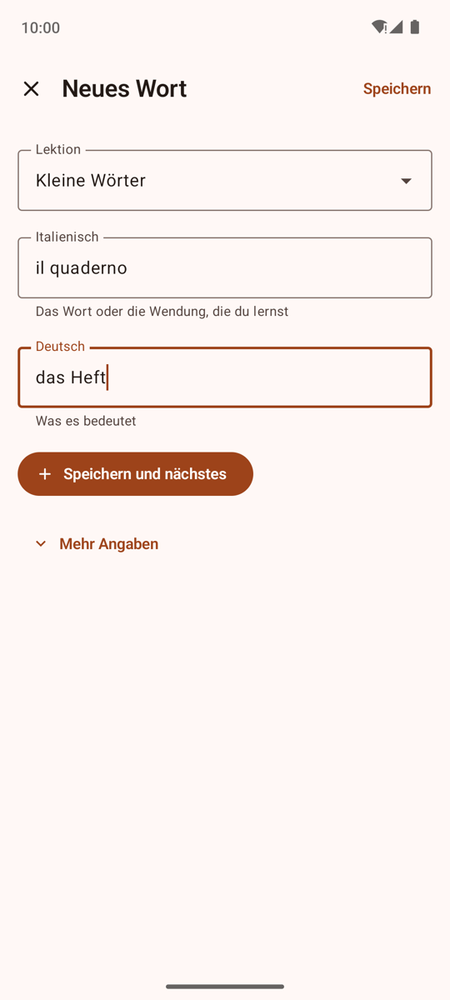

**Ein Paket erstellen.** Tippe in den **Sprachpaketen** auf die Plus-Taste und wähle **Neues Paket** (oder **Neues
Paket aus Foto**, siehe [Wörter aus Fotos](#wörter-aus-fotos)). Gib einen Titel ein, die Sprache, die du kannst, und
die, die du lernst, in welche Richtungen die Karten gelernt werden können (**Beide**, **Erkennen** oder **Bilden**)
und eine Lizenz, dann tippe auf **Erstellen**. Der Editor öffnet sich. Mit **Paket-Einstellungen** oben im Editor
änderst du das alles später; die Sprachen stehen fest, sobald das Paket Wörter enthält.

**Wörter hinzufügen.** Tippe unten auf die Plus-Taste und wähle **Wort hinzufügen**. Ein Wort und seine Übersetzung
genügen. **Speichern und nächstes** lässt die Tastatur offen, so tippst du eine ganze Liste ab. **Mehr Angaben**
ergänzt Wortart, Genus, Plural, einen Beispielsatz und ein Bild; gib dem Bild eine Beschreibung, die Screenreader
vorlesen. wörds weist dich auf ein Wort hin, das schon im Paket ist. Alles wird laufend gespeichert, und du kannst
das Paket sofort lernen.

**Lektionen** gruppieren die Wörter wie die Kapitel eines Lehrbuchs. Du kannst eine Lektion allein lernen, und ihre
Reihenfolge bestimmt, welche neuen Wörter in deiner täglichen Wiederholung zuerst kommen. Mit **Lektionen** oben im
Editor legst du sie an, benennst sie um, sortierst und löschst sie; **Lektion hinzufügen** im Menü der Plus-Taste
unten legt ebenfalls eine an, und die Plus-Taste im Kopf einer Lektion fügt direkt dort ein Wort hinzu.

**Wörter ändern.** Tippe auf ein Wort, um es zu bearbeiten; sein Lernfortschritt bleibt erhalten. **Weitere Optionen
→ Fortschritt zurücksetzen** lässt dich es von vorn lernen, **Wort löschen** entfernt es. Ziehe ein Wort am Griff, um
es umzusortieren, oder über den Kopf einer Lektion hinweg, um es in diese Lektion zu verschieben. Halte ein Wort
gedrückt, um mehrere auszuwählen; die Leiste unten verschiebt sie dann in eine andere Lektion (**In Lektion
verschieben**) oder in eine neue (**Neue Lektion**) oder löscht sie (**Löschen**). Mit TalkBack findest du dieselben
Aktionen im Aktionsmenü jedes Worts und jeder Lektion.

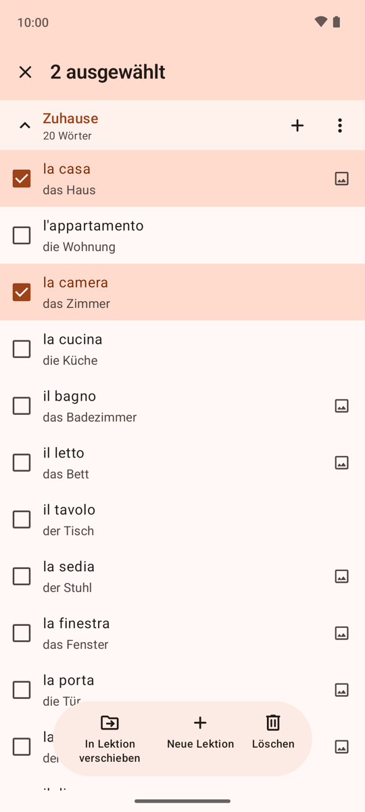

**Ein installiertes Paket bearbeiten.** Installierte Pakete lassen sich nicht ändern. Ihr Menü (⋮) bietet **Zum
Bearbeiten duplizieren**: wörds legt eine bearbeitbare Kopie an, die deinen Lernfortschritt behält, und blendet das
Original aus (*Ausgeblendet*). **Original einblenden** holt es zurück. Deine eigenen Pakete sind als *Bearbeitbar*
markiert; ihr Menü hat **Bearbeiten**, **Als Datei exportieren**, **Teilen**, **Duplizieren** und **Löschen**.

**Exportieren und teilen.** **Als Datei exportieren** speichert dein Paket als `.linguapack`-Datei in einem Ordner
deiner Wahl, **Teilen** schickt es an eine App, und **Alle deine Pakete exportieren** (oben in den Sprachpaketen)
schreibt alle in einen Ordner. Die Lizenz, die du gewählt hast, geht mit der Datei. Wer wörds hat, öffnet die Datei
mit **Datei importieren**; sie kommt als bearbeitbares Paket an. Ist das Paket schon da, wähle **Ersetzen** (Wörter,
die in beiden sind, behalten ihren Lernstand) oder **Beide behalten**.

## Wörter aus Fotos

wörds kann eine gedruckte Wortliste aus Fotos lesen, damit du sie nicht abtippen musst. Der Text wird auf deinem
Gerät gelesen; deine Fotos werden nie hochgeladen.

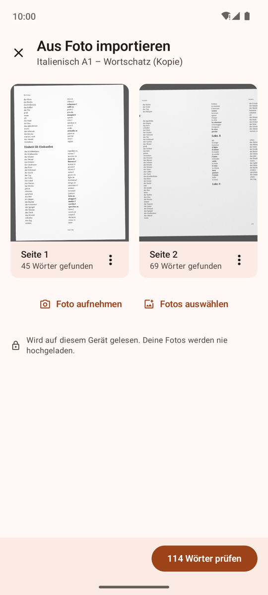 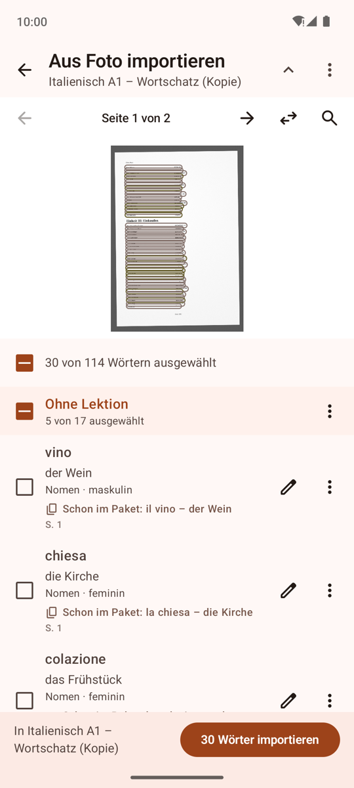

1. Tippe im Editor auf die Plus-Taste und wähle **Aus Foto importieren**. Oder beginne ein Paket mit **Neues Paket
   aus Foto** in den **Sprachpaketen**.
2. **Foto aufnehmen** öffnet deine Kamera-App, **Fotos auswählen** die Fotoauswahl, in der du mehrere Seiten wählen
   kannst. wörds sieht nur die Fotos, die du wählst, und fragt nach keiner Berechtigung. Nimm eine Seite pro Foto
   auf, so gerade und scharf wie möglich.
3. Jede Seite wird gelesen, während du weitermachst; ein seitlich aufgenommenes Foto dreht wörds selbst. Liest sich
   eine Seite schlecht, bietet ihr Menü **Drehen und zuschneiden**: drehe sie und ziehe die Ecken an die Wortliste.
4. Tippe auf ***n* Wörter prüfen**, um sie durchzusehen. Das Foto zeigt einen Rahmen um jedes gefundene Paar; tippe auf
   einen Rahmen, um seine Zeile zu finden, oder auf eine Zeile, um zu sehen, wo sie gelesen wurde. Zeilen mit
   **Schreibweise prüfen** waren schwer zu lesen, und Wörter, die schon im Paket sind, bleiben abgewählt. Tippe auf
   den Stift, um eine Zeile zu berichtigen, wähle ab, was du nicht willst, und tausche mit **Spalten dieser Seite
   tauschen**, wenn Wort und Übersetzung vertauscht sind. Überschriften auf der Seite werden zu Lektionen; **In
   Lektion verschieben …** legt Zeilen in eine andere oder neue.
5. Tippe auf ***n* Wörter importieren**, um die ausgewählten Wörter hinzuzufügen. Die Zusammenfassung zeigt, wie viele Wörter in
   welche Lektionen gingen. **Rückgängig** entfernt sie wieder und bringt dich zurück zur Prüfung.

Du kannst einen Import verlassen und später weitermachen; er wartet, wo du aufgehört hast. **Verwerfen** löscht die
Fotos und alles, was daraus gelesen wurde. Ein Import, der einen Tag liegen bleibt, wird gelöscht.

## Einstellungen

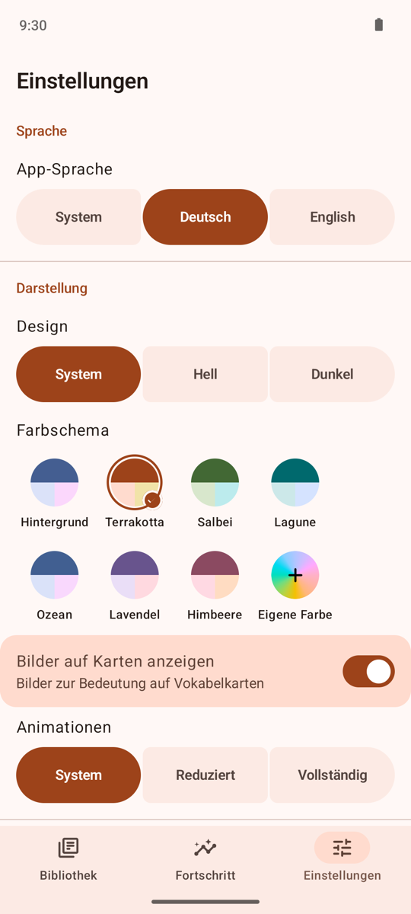 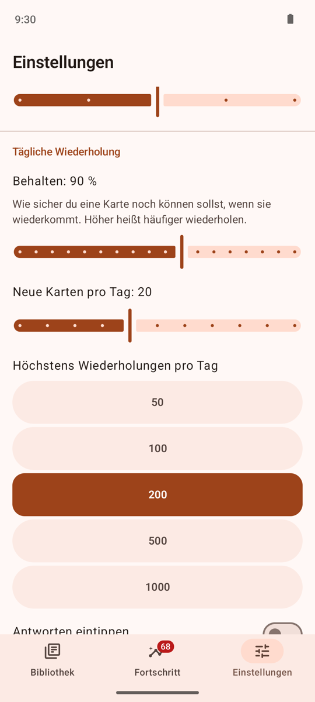

### Sprache

- **App-Sprache**: wie im System, oder immer Deutsch oder Englisch.

### Darstellung

- **Design**: hell, dunkel oder wie auf deinem Gerät eingestellt.
- **Farbschema**: die Farben deines Hintergrundbilds (ab Android 12), eines von sechs Farbschemata oder eine eigene
  Farbe. Die Farben folgen der Kontrasteinstellung des Systems (ab Android 14).
- **Bilder auf Karten anzeigen** schaltet die Bilder auf Vokabelkarten ein oder aus.
- **Animationen**: wie auf deinem Gerät eingestellt, reduziert oder vollständig.

### Aussprache

- **Automatisch abspielen** spricht die Antwort, sobald eine Karte umgedreht wird.
- **… beim Anzeigen abspielen** spricht die Lernsprache, sobald eine Karte sie auf der Vorderseite zeigt.
- **Sprechtempo** macht die Stimme langsamer oder schneller.

### Tägliche Wiederholung

- **Behalten**: wie sicher du eine Karte noch können sollst, wenn sie wiederkommt (80 bis 97 %, normalerweise
  90 %). Höher heißt häufiger wiederholen.
- **Neue Karten pro Tag** und **Höchstens Wiederholungen pro Tag** begrenzen, wie viel die tägliche Wiederholung
  enthält.
- **Antworten eintippen**: In der heutigen Wiederholung tippst du jede Antwort ein, statt die Karte umzudrehen.
- **Fehlende Akzente akzeptieren** lässt eine Antwort, die sich nur in Akzenten unterscheidet, als fast richtig
  gelten; ausgeschaltet ist sie falsch.
- **Fehlenden Artikel akzeptieren** lässt ein Nomen ohne Artikel als fast richtig gelten; ausgeschaltet ist es falsch.
- **Tägliche Erinnerung** und ihre **Uhrzeit**: siehe [Erinnerung und Widget](#erinnerung-und-widget).

### Daten

- **Sprachpakete** öffnet die [Paketverwaltung](#sprachpakete).
- **Lernfortschritt zurücksetzen** löscht alle Antworten und Sitzungen, auch die des Artikeltrainings. Installierte
  Pakete bleiben. Das lässt sich nicht rückgängig machen.

### Über wörds

- **Open-Source-Lizenzen** listet die Bibliotheken, mit denen wörds gebaut ist; tippe auf eine, um ihre Lizenz zu
  lesen.

**Eigene Farbe**: Wähle Farbton und Farbigkeit (oder gib einen Hex-Code ein) und einen Stil. Die Vorschau zeigt das
Ergebnis hell und dunkel.

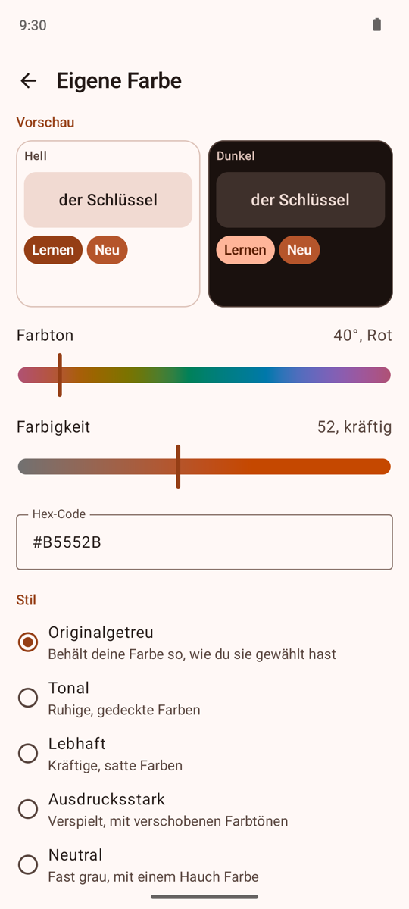 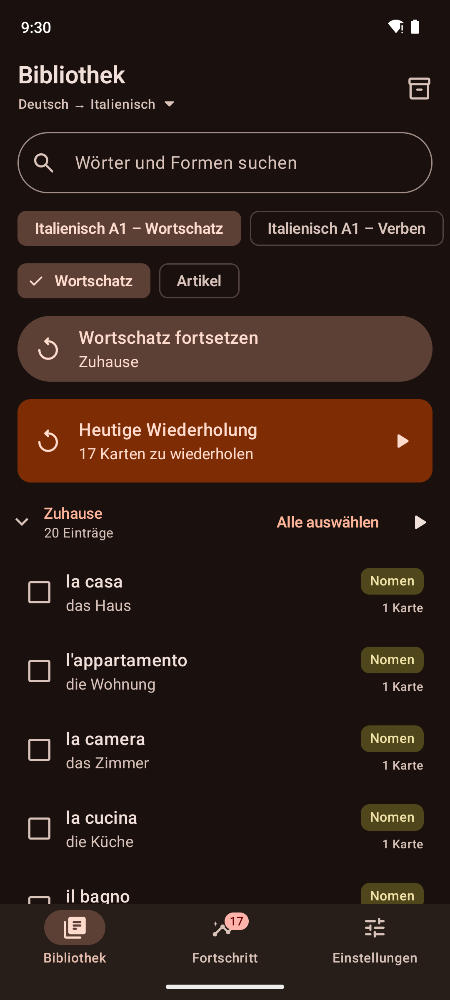

## Tablets und Foldables

Auf großen Bildschirmen wandert die Navigation an die Seite, und die GitHub-Quellen zeigen die Liste der Quellen
und die Pakete der gewählten Quelle nebeneinander. Der Paket-Editor zeigt die Wortliste und das Wort, das du
bearbeitest, nebeneinander, die Prüfung eines Foto-Imports die Zeilen und das Foto. Auf einem halb geöffneten Foldable (Tischmodus) liegt die Karte
über dem Knick und die Bewertungstasten darunter – so kannst du mit dem Gerät auf dem Tisch lernen. Solange die
Bildschirmtastatur für eine eingetippte Antwort offen ist, rückt alles über den Knick.

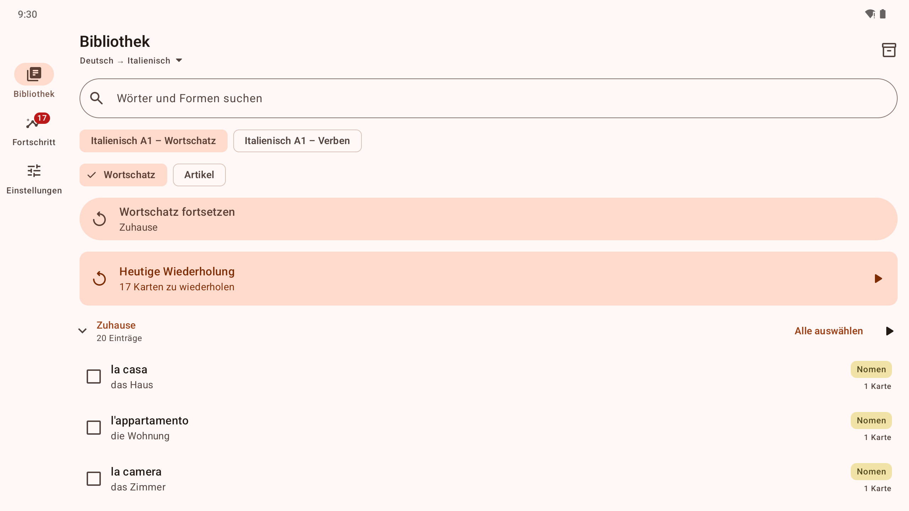

## Barrierefreiheit und Datenschutz

- wörds funktioniert mit **TalkBack**, großer Schrift, hohem Kontrast, reduzierten Animationen, Tastatur und
  D-Pad. Auf einer Hardwaretastatur geht **Esc** zurück.
- wörds braucht **kein Konto** und funktioniert **offline**. Ins Internet geht es nur, um mit GitHub zu sprechen,
  und nur, wenn du GitHub-Quellen nutzt. Es gibt keine Werbung und kein Tracking. Fotos von Wortlisten werden auf
  deinem Gerät gelesen und nie hochgeladen.
- Dein Fortschritt, deine Einstellungen und deine eigenen Pakete sind Teil der Sicherung deines Geräts.
  Zugriffstokens nicht: Nach einer Wiederherstellung fragt wörds erneut danach.

## Fragen und Probleme

**Eine Karte hat keinen Ton.** Deinem Gerät fehlt die Stimme der Sprachausgabe für diese Sprache. Tippe in der
Meldung auf der Karte auf **Installieren** oder füge die Stimme in den Sprachausgabe-Einstellungen deines Geräts
hinzu.

**Ein Paket wurde nicht installiert.** Die Meldung sagt, was damit nicht stimmt. Auf deinem Gerät wurde nichts
geändert. Bitte den Autor des Pakets um eine korrigierte Fassung.

**GitHub meldet einen Fehler.** Prüfe deine Verbindung. Bei einem privaten Repository prüfe, ob das Zugriffstoken
noch gültig ist und Lesezugriff auf die Inhalte des Repositorys hat. Ist das Anfragelimit von GitHub erreicht,
sagt die Meldung, wann du es wieder versuchen kannst.

**Wörter aus einem Foto kommen falsch an.** Fotografiere die Seite noch einmal bei gutem Licht, flach und
bildfüllend, oder schneide mit **Drehen und zuschneiden** nur die Wortliste aus. Jede Zeile lässt sich in der
Prüfung berichtigen, bevor etwas importiert wird.

**Ich will von vorn anfangen.** **Einstellungen → Lernfortschritt zurücksetzen** löscht alle Antworten; die Pakete
bleiben installiert.
