# wörds user guide

wörds is a flashcard app for the parts of a language that need daily practice: verb forms and everyday words.
Each card shows one side. You answer in your head, flip the card and grade yourself honestly – or you type the answer
and wörds checks it. wörds then works out when you should see the card again.

wörds works offline, needs no account and shows no ads. It comes with Italian for German speakers (A1 verbs and
120 everyday words); more language packs can be added from a file or from GitHub, and you can make your own,
also from photos of a word list.

This guide describes wörds 0.11.0. The screenshots show the Terracotta color scheme; your app may use other colors.

## Contents

- [Getting started](#getting-started)
- [The library](#the-library)
- [Starting a session](#starting-a-session)
- [Studying a card](#studying-a-card)
- [Typing the answer](#typing-the-answer)
- [End of a session](#end-of-a-session)
- [Today's review](#todays-review)
- [Reminder and widget](#reminder-and-widget)
- [Progress](#progress)
- [Practising articles](#practising-articles)
- [Language packs](#language-packs)
- [Your own packs](#your-own-packs)
- [Words from photos](#words-from-photos)
- [Settings](#settings)
- [Tablets and foldables](#tablets-and-foldables)
- [Accessibility and privacy](#accessibility-and-privacy)
- [Questions and problems](#questions-and-problems)

## Getting started

On first start wörds installs its built-in content and asks what you want to learn. Choose a language pair and
tap **Let's go**. You can install more pairs later and switch between them at any time.

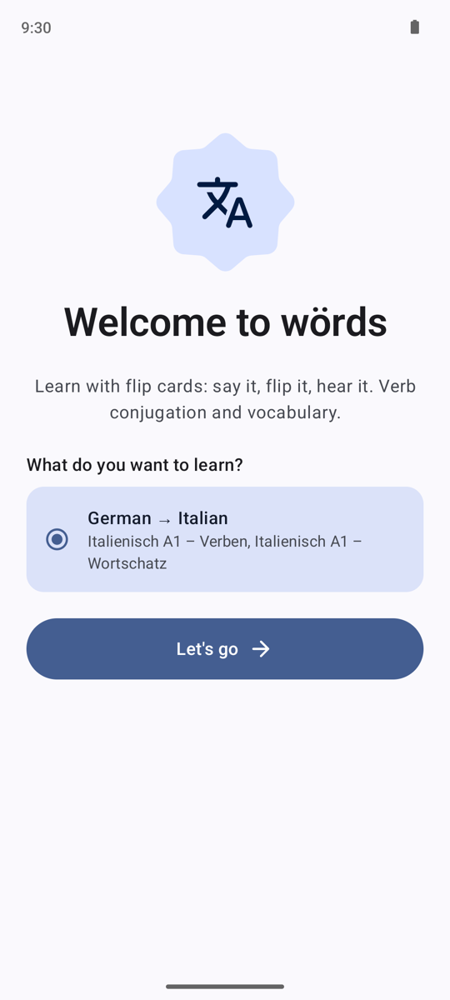

The app has three areas, always reachable from the bar at the bottom (on tablets: at the side):

| Area | What it is for |
|---|---|
| **Library** | Browse the content and start a session |
| **Progress** | Today's review and what you have learned so far |
| **Settings** | Language, colors, pronunciation, daily review, language packs |

## The library

The library shows everything you can learn in the current language pair. The row of chips at the top switches
between the installed packs, for example *Verben* (verb conjugation) and *Wortschatz* (vocabulary). Each pack is
divided into sections (lessons), and each section into items: a verb with all its forms, or a word.

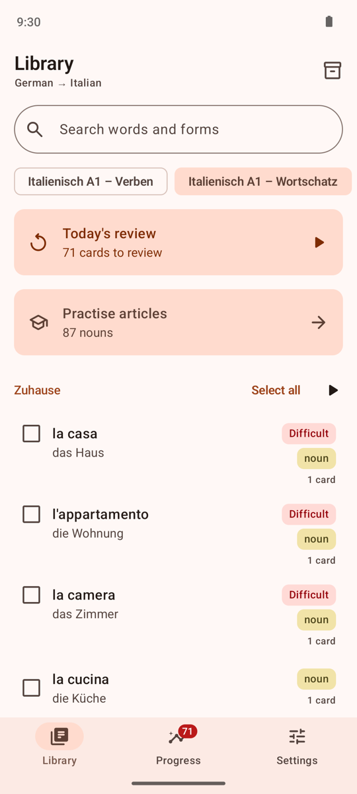 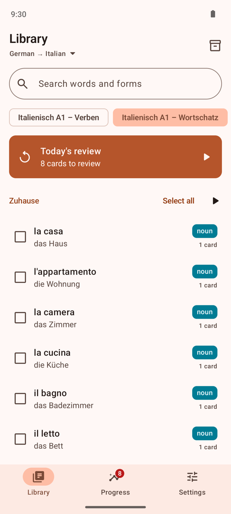

- **Search** finds words and verb forms in the selected pack.
- **Today's review** at the top starts or continues your daily review (see [Today's review](#todays-review)).
- **Continue last session** appears when a session is still open; it picks up exactly where you left off.
- The **▶ button** next to a section starts that whole section.
- With two or more language pairs installed, tap the pair under the title to switch between them.
- The **box icon** at the top right opens the [language packs](#language-packs).

To study only some items, tick them. **Select all** ticks a whole section; **Clear** at the top removes the
selection. The button at the bottom shows how many items you have chosen.

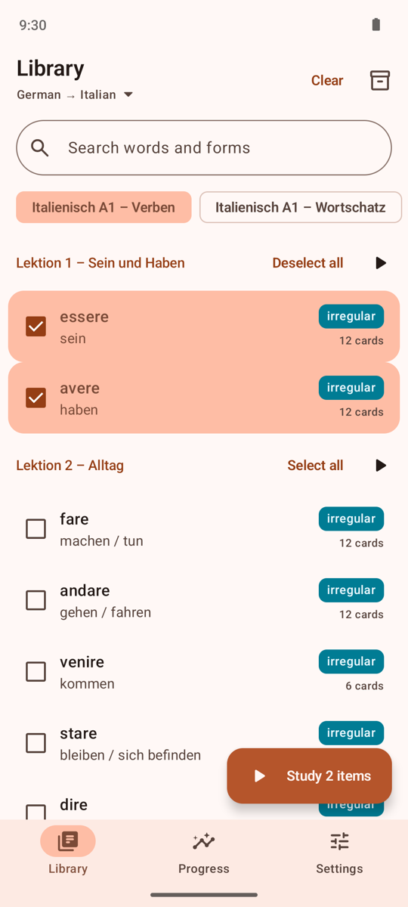 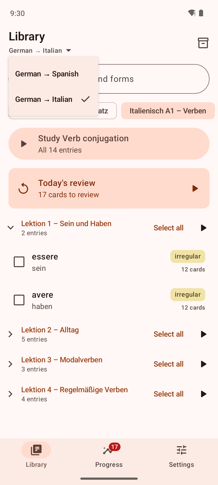

## Starting a session

Before a session starts, a sheet lets you decide how to practise:

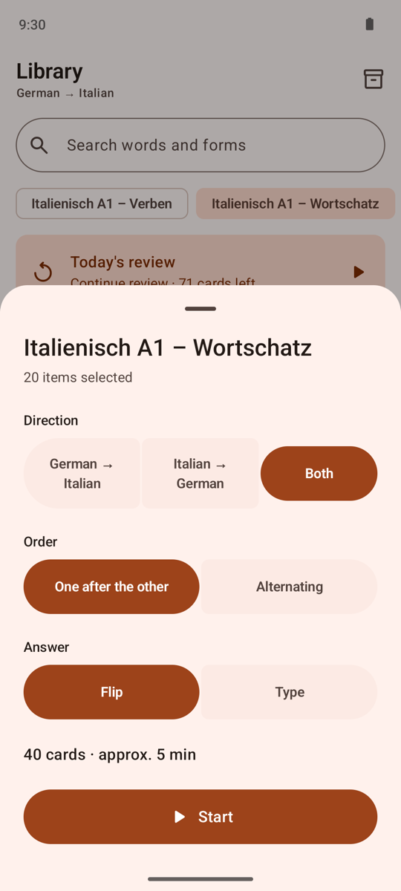

- **Direction**: from your language to the learned one (*German → Italian*: you are shown "ich bin" and say
  "io sono"), the other way round, or **Both**.
- **Order** (only with *Both*): **One after the other** practises all cards of an item in one direction, then in
  the other. **Alternating** asks each card in both directions in turn.
- **Tenses** (verbs only): choose which tenses to practise.
- **Answer**: **Flip** the card and grade yourself, or **Type** the answer (see [Typing the answer](#typing-the-answer)).
  wörds remembers your choice for each language pair.

The sheet shows how many cards that makes and roughly how long it takes. Tap **Start**.

## Studying a card

A card shows a prompt. Say or think the answer, then tap the card to flip it.

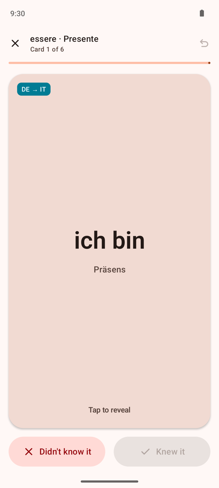 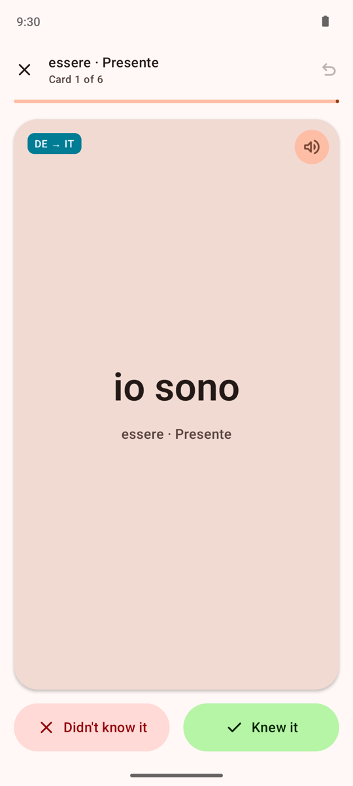

Then grade yourself:

- **Knew it**, or swipe the card to the right.
- **Didn't know it**, or swipe the card to the left.

Be honest: wörds plans your reviews from these answers. That is also why **Knew it** only becomes available once
the answer is visible. If you tap **Didn't know it** before flipping, the card shows its answer first; tap
**Didn't know it** again to move on.

More on the card screen:

- The **speaker** plays the pronunciation with your device's text-to-speech voice. If the voice for the language is
  missing, wörds offers to install it.
- **Undo** (the arrow at the top right, or the message at the bottom) takes back the last answer.
- The tag at the top left shows the direction, for example *DE → IT*.
- **✕** closes the session. It stays open, and you can continue it later from the library.

**Vocabulary cards** show the word, and on the answer side its article, plural and an example sentence where the
pack has one. Many words of the built-in Italian pack also have a picture of their meaning. You can turn pictures
off in the settings.

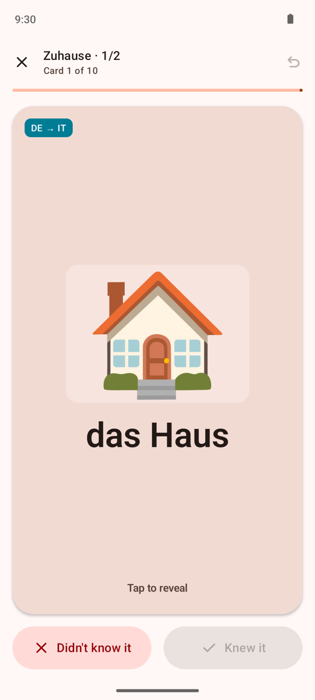 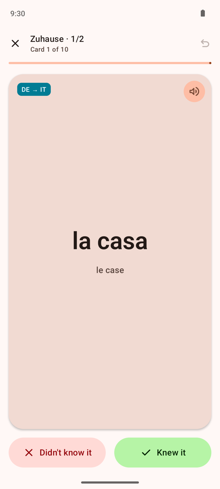

## Typing the answer

With **Answer: Type**, a field takes your answer in the language of the back of the card, and the keyboard switches to
that language where it can. Buttons above the keyboard insert letters it may lack, such as *à* or *è*. Tap **Check**
(or press Enter).

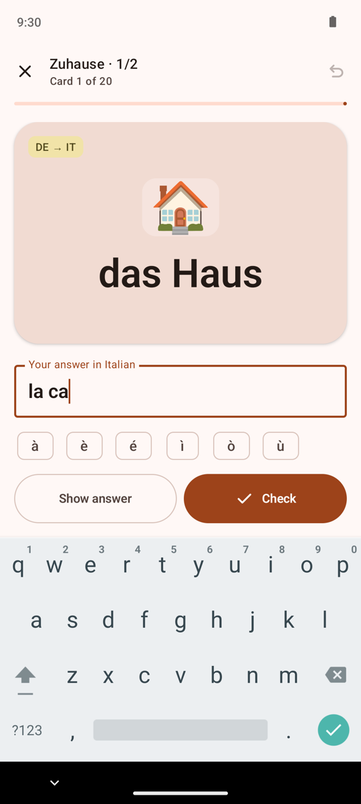 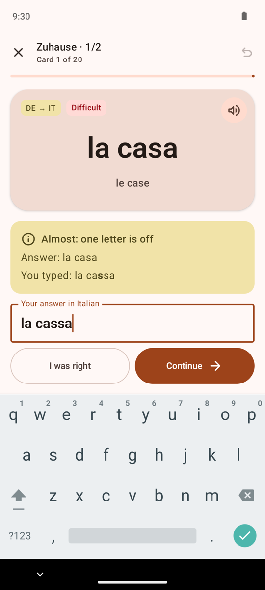

wörds compares your answer with the solution and says what it found:

- **Correct** counts as known.
- **Almost** – one letter off in a longer word, only the accents (when accepted), the wrong article, or no article
  (when accepted) – counts as *almost known*: the card comes back sooner than a known one, but later than a
  forgotten one.
- **Not quite** counts as not known.

Capital letters, extra spaces and punctuation never matter. Where a solution offers alternatives (*lui/lei è*), each
of them is right, and a subject pronoun the solution starts with may be left out (*sono* for *io sono*). Under the
verdict, the solution shows what was missing or different, and your answer shows what was wrong.

If wörds got it wrong, tap **I was right** to count the answer as known. **Show answer** gives up on a card; it then
counts as not known. What you type is never stored.

Typing works in both directions. For today's review, turn it on in **Settings → Daily review → Type answers**.

## End of a session

A session is split into groups: one per verb and tense, or a handful of words. After each group wörds shows how it went and what comes
next. At the end you see the result of the whole session.

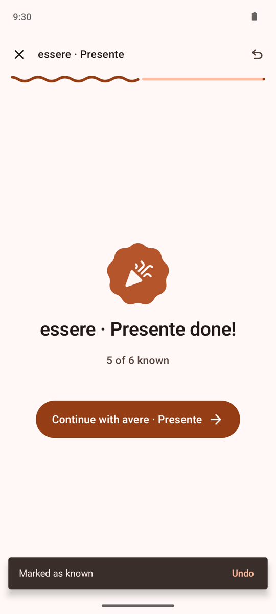 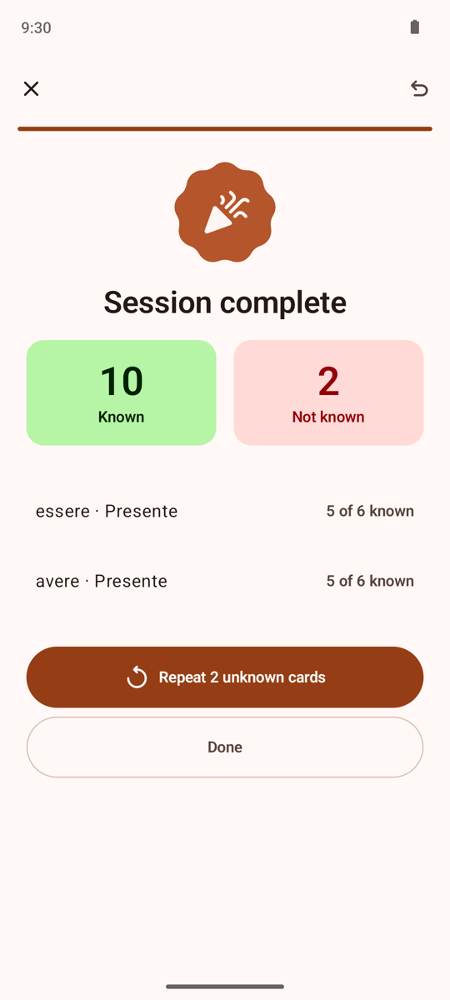

**Repeat unknown cards** starts a short session with just the cards you did not know. **Done** returns to the
library.

## Today's review

wörds uses *spaced repetition*: a card you know well comes back after a long break, a card you struggle with comes
back soon. Behind this is FSRS, a modern scheduling method that estimates for each card how likely you are to still
remember it.

Every day wörds puts together **today's review**:

- cards that are due, the ones you are most likely to forget first, and
- a few **new cards** from packs you have already started (20 a day unless you change it).

You start the review from the top of the library or from the **Progress** tab. A number on the Progress tab shows
how many cards are waiting. Long reviews are split into blocks of 20 cards. A review you interrupt can be continued
the same day. A review day starts at 4:00 in the morning, so a late evening session still counts for that day.

Every answer counts towards your schedule: in a normal session as well as in the review.

## Reminder and widget

**Settings → Daily review → Daily reminder** sends a notification at the time you choose (19:00 unless you change it),
but only on days when today's review still has cards for you. It asks for permission to show notifications when you
turn it on; the notification names no words.

The **Today's review** widget for your home screen shows how many cards are waiting and starts the review with one
tap. When you are done for the day, it says so and opens Progress. It follows the app's colors.

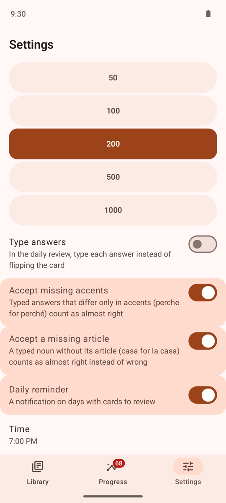

## Progress

The **Progress** tab shows today's review and, for each pack, how far you have got. Tap a pack to see the same
figures per section; within a section you can show its groups.

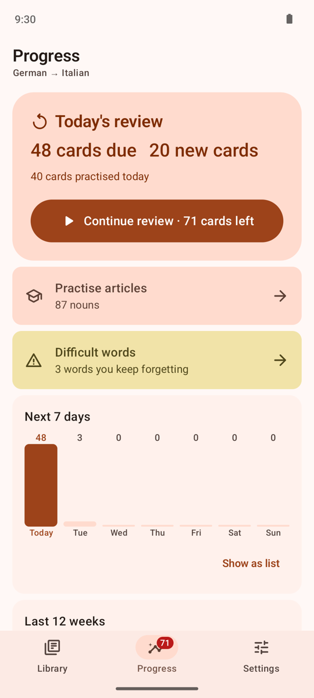 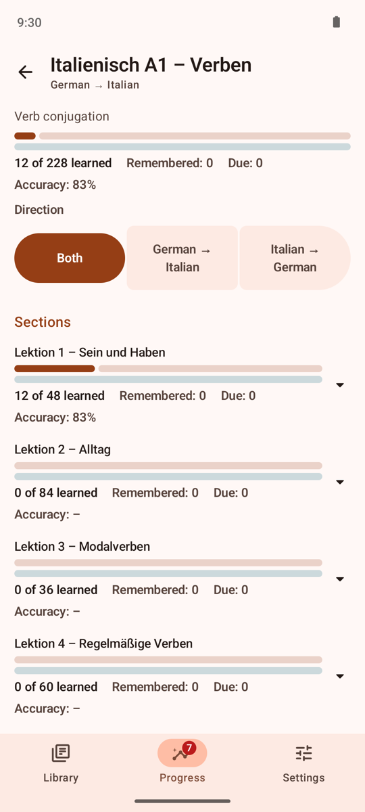

| Figure | Meaning |
|---|---|
| **learned** | Cards you have answered at least once |
| **Remembered** | Cards you would still know after three weeks or more |
| **Due** | Cards that are due for review now |
| **Accuracy** | Share of answers marked *Knew it* |

The **Direction** buttons show the figures for one direction or both.

Above the packs, Progress shows:

- **Difficult words**: words you forgot three times or more after you had known them. Tap the card to see them. From
  the list you can **edit** a word (a word of an installed pack is edited in a copy of the pack, which keeps your
  progress), or **reset** it to learn it from scratch. A word leaves the list once you remember it for three weeks.
  In the library, the editor and on the answer side of a card, these words are marked **Difficult**.
- **Next 7 days**: how many cards are due each day, overdue ones counted today.
- **Last 12 weeks**: a calendar of the days you studied; the darker a day, the more answers you gave. **Show as list**
  spells both charts out as a table.

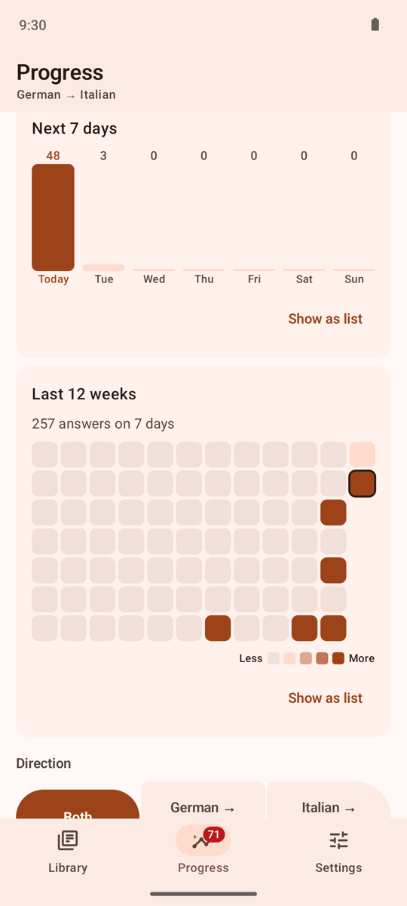 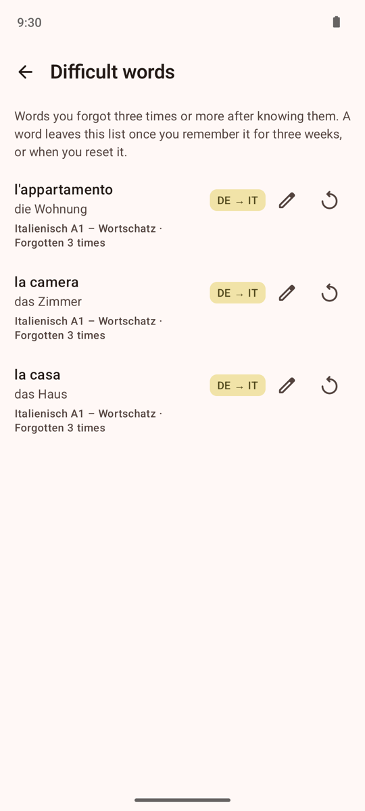

## Practising articles

**Practise articles** asks only for the article of nouns: *casa* – is it *il*, *lo*, *la* or *l'*? You find it in the
library (for the selected pack) and in Progress (for all packs of the language pair), once there are at least five
nouns with their article.

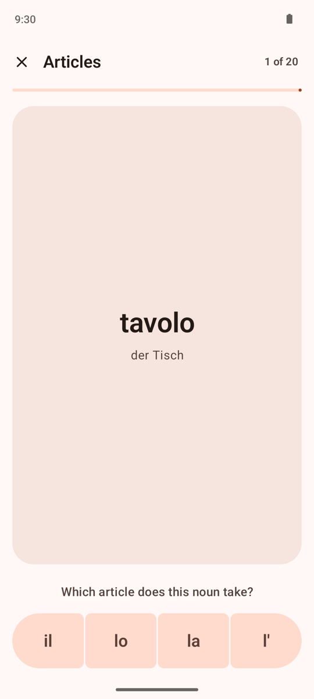 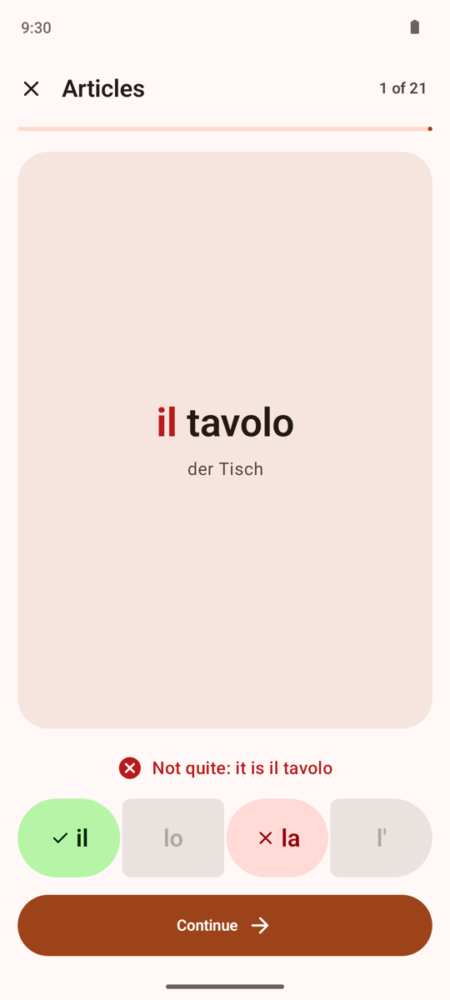

A round has up to 20 nouns. After a right answer the next noun follows by itself; after a wrong one, wörds shows the
right article until you tap **Continue**, and asks that noun once more at the end of the round. The next round starts
with the nouns you got wrong.

Practising articles does not change your schedule or today's review, but its answers count in the calendar.

## Language packs

All content comes in language packs. Open them from the box icon in the library, or via **Settings → Language
packs**.

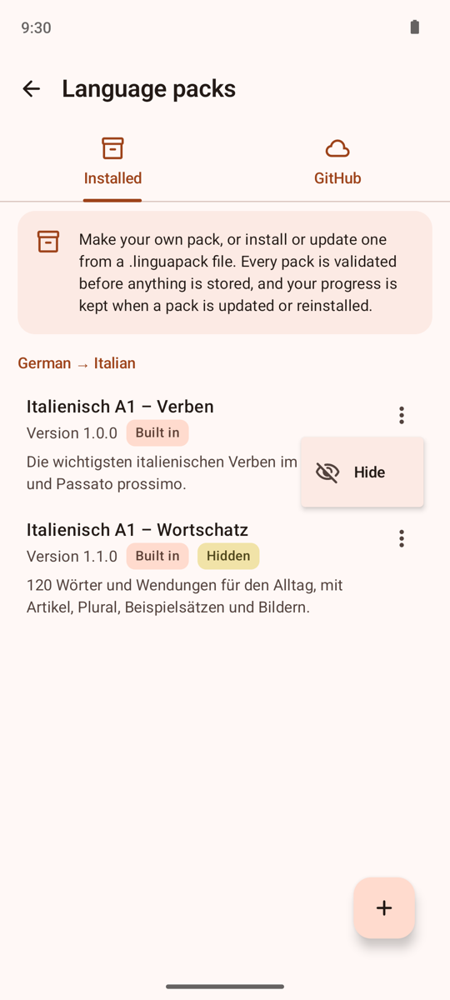 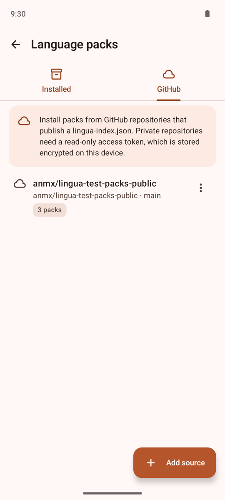

**Installed** lists your packs by language pair, with version and origin (*Built in*, *Imported file* or
*GitHub*).

- **Import file** installs or updates a pack from a `.linguapack` file, for example from your downloads.
- The bin icon removes a pack. Your learning progress is kept and comes back if you install the pack again.
  Built-in packs cannot be removed.

**GitHub** installs packs from GitHub repositories that publish a pack index (`lingua-index.json`):

1. Tap **Add source** and enter the owner and name of the repository. You can also paste a GitHub link into the
   owner field. Branch and folder are optional.
2. For a **private** repository, add a fine-grained access token with read-only access to that repository's
   contents. wörds stores it encrypted, with a key that never leaves your device. Showing, replacing or deleting
   a saved token requires your fingerprint, face or screen lock.
3. Save. wörds shows the packs the repository offers. Tap **Install**.

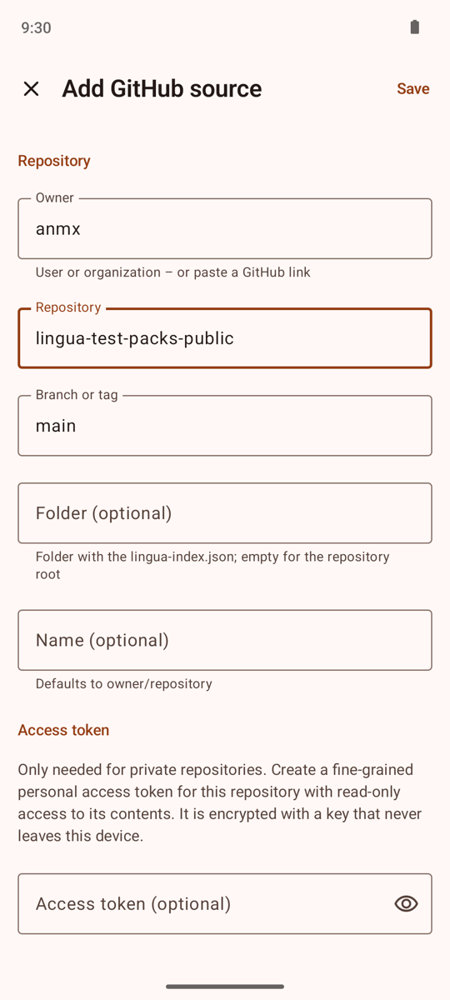 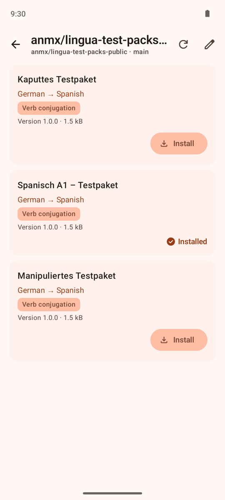

wörds checks once a day, on Wi-Fi, whether your sources have new versions, and shows **Update** where one is
available. Large downloads continue in the background with a notification.

**Every pack is checked before anything is stored.** A damaged file, a pack that does not match its checksum or
content that breaks the rules is rejected, and wörds tells you why. Nothing on your device changes in that case.

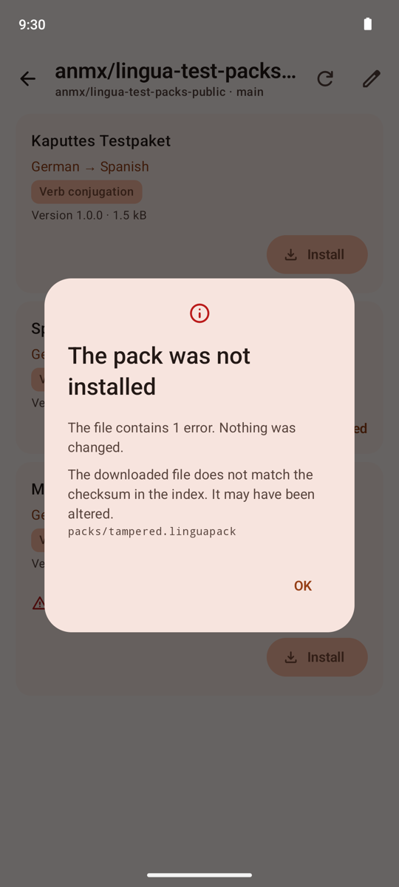

## Your own packs

Make a pack of your own words, for example the vocabulary of your textbook, and study it like any other pack.

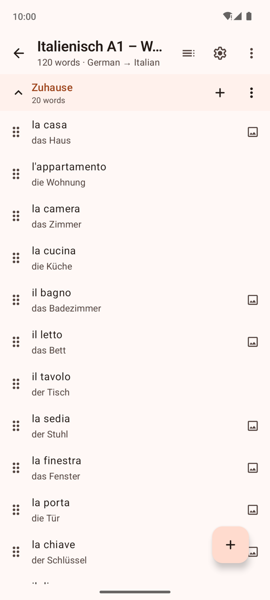 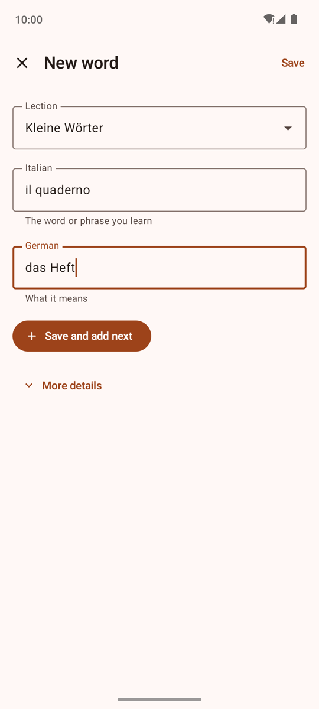

**Create a pack.** In **Language packs**, tap the add button and choose **New pack** (or **New pack from photo**, see
[Words from photos](#words-from-photos)). Enter a title, the language you know and the one you are learning, which
way the cards can be studied (**Both**, **Recognize** or **Produce**) and a license, then tap **Create**. The editor
opens. **Pack settings** in the editor's top bar changes all of this later; the languages are fixed once the pack has
words.

**Add words.** Tap the add button at the bottom and choose **Add word**. A word and its translation are enough. **Save
and add next** keeps the keyboard open, so you can type a whole list. **More details** adds the part of speech,
gender, plural, an example sentence and a picture; give the picture a description, which screen readers read aloud.
wörds points out a word that is already in the pack. Everything is saved as you go, and the pack can be studied at
once.

**Lections** group the words like the chapters of a textbook. You can study one lection at a time, and their order
decides which new words come first in your daily review. **Lections** in the top bar adds, renames, reorders and
deletes them; the add button on a lection's header adds a word right there.

**Change words.** Tap a word to edit it; it keeps its learning progress. **More options → Reset progress** lets you
learn it from the start, **Delete word** removes it. Drag a word by its handle to reorder it within its lection.
Touch and hold a word to select several, then move them to another lection or delete them. With TalkBack, the same
actions are in the actions menu of each word and lection.

**Edit an installed pack.** Installed packs cannot be changed. Their menu (⋮) offers **Duplicate to edit**: wörds
makes an editable copy that keeps your learning progress, and hides the original, marked *Hidden*. **Show original**
brings it back. Your own packs are marked *Editable*; their menu has **Edit**, **Export to file**, **Share**,
**Duplicate** and **Delete**.

**Export and share.** **Export to file** saves your pack as a `.linguapack` file in a folder you choose, **Share**
sends it to an app, and **Export all your packs** (top bar of the language packs) writes all of them into one folder.
The license you chose goes with the file. Anyone with wörds can open the file with **Import file**; it arrives as an
editable pack. If that pack is already there, choose **Replace** (words in both keep their progress) or **Keep both**.

## Words from photos

wörds can read a printed word list from photos, so you don't have to type it. The text is read on your device; your
photos are never uploaded.

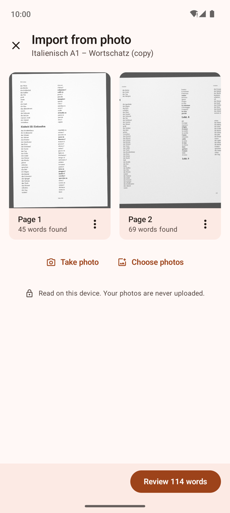 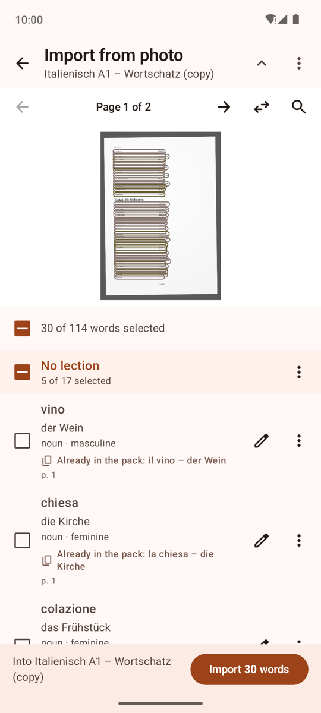

1. In the editor, tap the add button and choose **Import from photo**. Or start a pack with **New pack from photo**
   in **Language packs**.
2. **Take photo** opens your camera app; **Choose photos** opens the photo picker, where you can pick several pages.
   wörds sees only the photos you choose and asks for no permission. Take one page per photo, as straight and
   sharp as you can.
3. Each page is read while you go on: a photo that came sideways is turned by itself. If a page reads badly, its
   menu offers **Rotate and crop**: turn it and drag the corners to the word list.
4. Tap **Review *n* words** to check them. The photo shows a frame around each pair found; tap a frame to find its row,
   or a row to see where it was read. Rows marked **Check the spelling** were hard to read, and words already in the
   pack are left unchecked. Tap the pencil to correct a row, uncheck what you don't want, and use **Swap the columns
   of this page** if word and translation came out the wrong way round. Headings found on the page become lections;
   **Move to lection…** puts rows into another or a new one.
5. Tap **Import *n* words** to add the checked words. The summary says how many words went into which lections. **Undo**
   removes them again and takes you back to the review.

You can leave an import and come back later; it waits where you left it. **Discard** deletes the photos and
everything read from them. An import left for a day is deleted.

## Settings

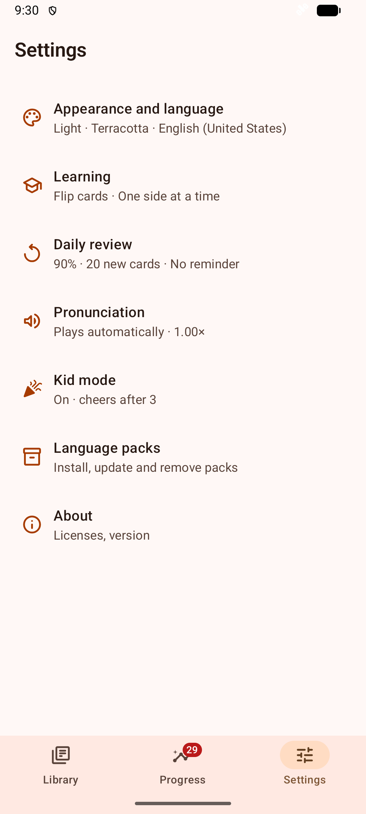 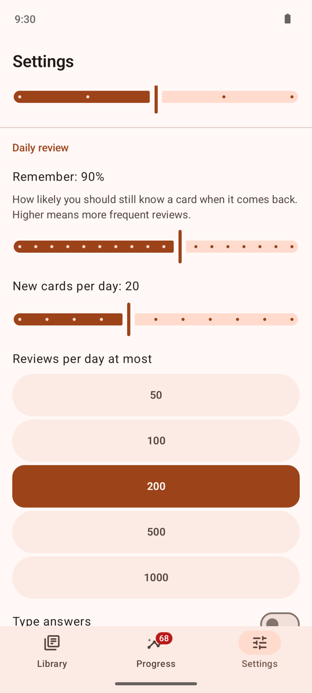

### Language

- **App language**: follow the system, or always German or English.

### Appearance

- **Theme**: light, dark, or as set on your device.
- **Color scheme**: the colors of your wallpaper (Android 12 and later), one of six schemes, or a color of your
  own. Colors follow the system's contrast setting (Android 14 and later).
- **Show pictures on cards** turns the pictures on vocabulary cards on or off.
- **Animations**: as set on your device, reduced, or full.

### Pronunciation

- **Play automatically** speaks the answer when a card is flipped.
- **Play … when shown** speaks the learned language as soon as a card appears with it on the front.
- **Speech rate** makes the voice slower or faster.

### Daily review

- **Remember**: how sure you want to be that you still know a card when it comes back (80 to 97 %, normally 90 %).
  Higher means more frequent reviews.
- **New cards per day** and **Reviews per day at most** limit how much each day's review contains.
- **Type answers** asks you to type each answer in today's review instead of flipping the card.
- **Accept missing accents** counts an answer that differs only in accents as almost right; turned off, it is wrong.
- **Accept a missing article** counts a noun without its article as almost right; turned off, it is wrong.
- **Daily reminder** and its **Time**: see [Reminder and widget](#reminder-and-widget).

### Data

- **Language packs** opens the [pack management](#language-packs).
- **Reset learning progress** deletes all answers and sessions, including those of the article practice. Installed
  packs stay. This cannot be undone.

### About wörds

- **Open-source licenses** lists the libraries wörds is built with; tap one to read its license.

**Custom color**: pick a hue and colorfulness (or enter a hex code) and a style. The preview shows the result in
light and dark.

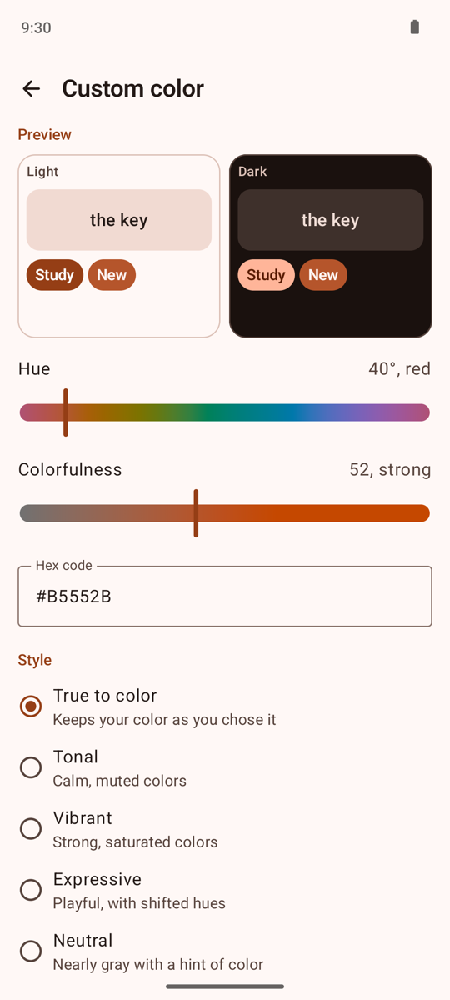 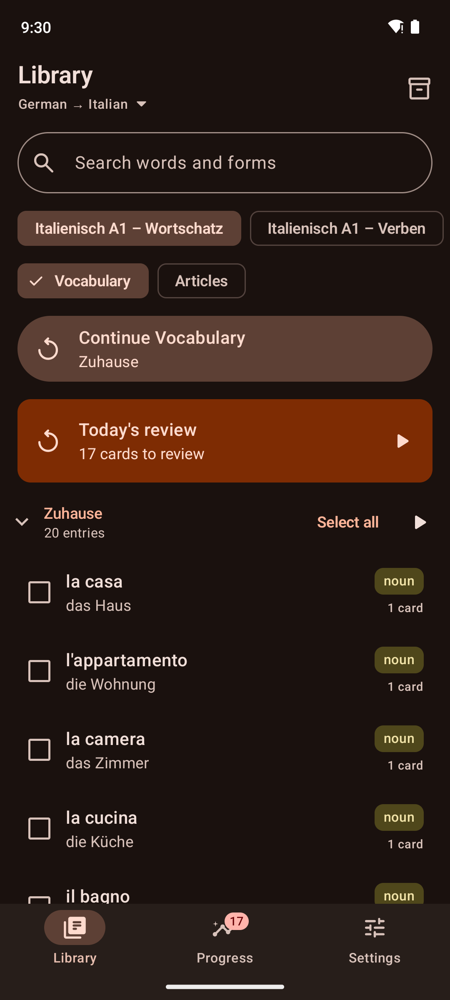

## Tablets and foldables

On large screens the navigation moves to the side, and the GitHub sources show the list of sources and the packs of
the selected source side by side. The pack editor shows the word list and the word you edit side by side, and the
review of a photo import the rows and the photo. On a half-folded foldable (tabletop posture), the card sits above the fold and the
grade buttons below it, so you can study with the device standing on a table. While the on-screen keyboard is open
for a typed answer, everything moves above the fold.

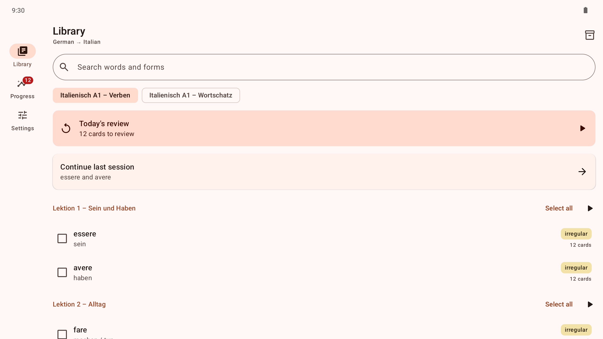

## Accessibility and privacy

- wörds works with **TalkBack**, large text, high contrast, reduced motion, keyboards and D-pads. On a hardware
  keyboard, **Esc** goes back.
- wörds needs **no account** and works **offline**. It only goes online to talk to GitHub, and only when you use
  GitHub sources. There are no ads and no tracking. Photos of word lists are read on your device and never
  uploaded.
- Your progress, settings and own packs are part of your device's backup. Access tokens are not: after a restore,
  wörds asks for them again.

## Questions and problems

**A card has no sound.** Your device lacks the text-to-speech voice for the language. Tap **Install** in the message
on the card, or add the voice in your device's speech settings.

**A pack was not installed.** The message says what is wrong with it. Nothing has been changed on your device. Ask
the author of the pack for a corrected version.

**GitHub reports an error.** Check your connection. For a private repository, check that the access token has not
expired and grants read access to the repository's contents. If GitHub's request limit has been reached, the
message says when you can try again.

**Words from a photo come out wrong.** Take the photo again in good light, with the page flat and filling the
picture, or use **Rotate and crop** to frame just the word list. Every row can be corrected in the review before
anything is imported.

**I want to start over.** **Settings → Reset learning progress** deletes all answers; the packs stay installed.
